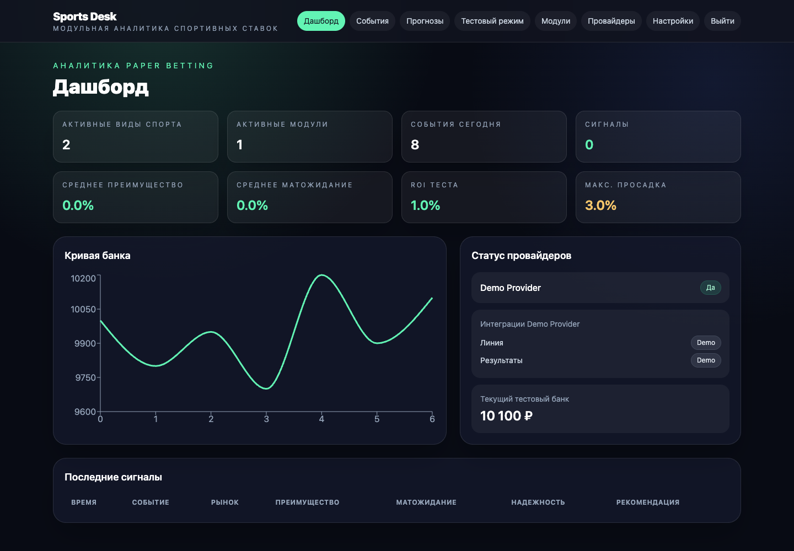
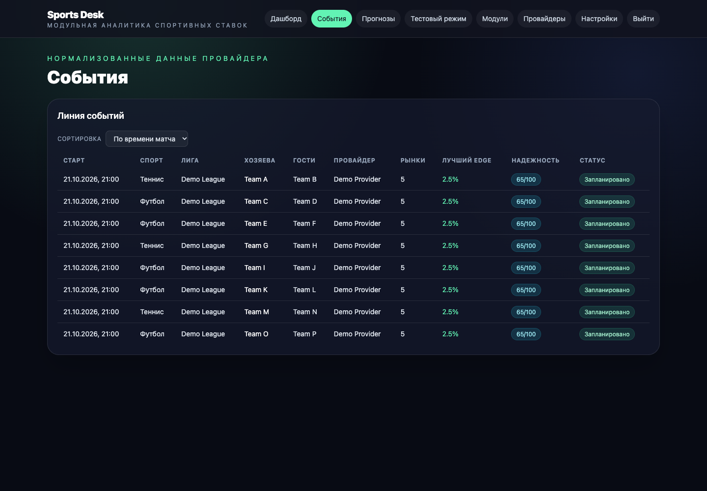

<a href="README.md">English</a> · <a href="README.ru.md">Русский</a>

<h1 align="center">Sports Analytics</h1>

A sports analytics workspace for exploring events, comparing signals and running paper simulations.

   

A public showcase of a private project, presenting anonymized interfaces and key workflows. Source code and internal project materials remain private.

## Key workflows

- Browse sports events
- Compare analytical signals
- Run paper simulations

## Gallery

Screens are presented individually with their proportions preserved. Identifying branding, contacts and data are replaced with demo content. These previews illustrate the product and do not imply a live service is available.

### Analytics overview

### Event list

---

[Explore all projects](https://github.com/svllvsx)
